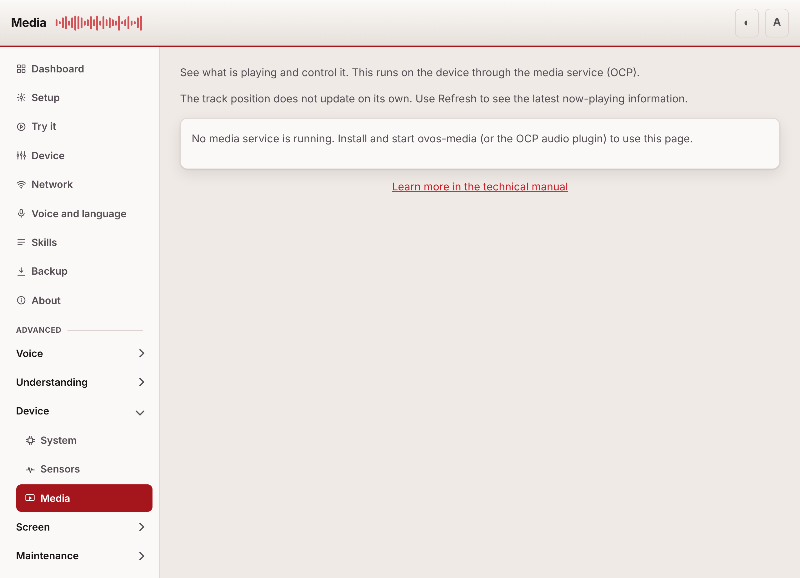
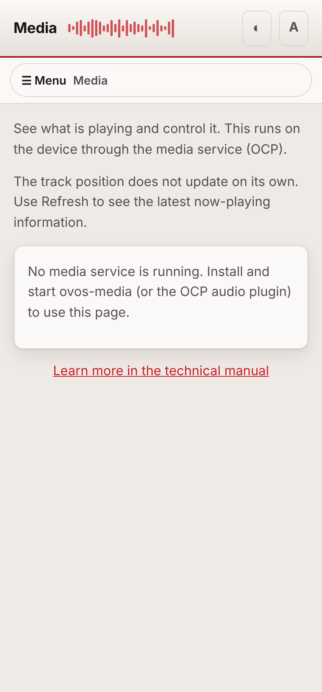

# ovos-control-panel-media

The Media page for
[ovos-control-panel](https://github.com/OpenVoiceOS/ovos-control-panel): what
the device is playing, play and pause, the queue, shuffle and repeat, seeking,
the volume, the other matches for what you asked for, and the songs you have
liked.

It is a **panel extension**: a page for the panel, nothing more. It was one of
the panel's own pages up to 0.0.1a85; it left so that a device that plays no
media (a reception desk, a phone line) does not carry it. Install it beside the
panel where the device plays media:

```
pip install --pre ovos-control-panel-media
```

(`--pre`, as for the panel itself.) Then restart the panel. It works with
`ovos-media` and with the older `ovos-plugin-common-play`: both answer the
`ovos.common_play.*` messages it uses.

## The page

The Media page shows what the device is playing and lets you control it. You can
play or pause, skip to the next or previous track, stop playback, and set the
volume.




## What you need

The device must run a media service. This is either `ovos-media` or the older
common-play plugin. If no media service answers, the page tells you so and hides
the controls.

## Now playing

The card at the top shows the current track. It shows the title, the artist, and
the cover art when the skill provides them. It also shows the state: playing,
paused, or stopped.

The page does not update on its own. Select **Refresh** to read the current track
again.

## Controls

- **Previous** and **Next** move through the playlist.
- **Play / Pause** starts or holds playback.
- **Stop** ends playback.

## Volume

Move the slider to set the volume from 0 to 100. Select **Mute** to silence the
device, and **Unmute** to restore the sound.

## Your own media

With [ovos-skill-local-media](https://github.com/OpenVoiceOS/ovos-skill-local-media)
installed where the panel runs, the page also has a card for your own files.
Choose one of the skill's folders (Music, Podcasts, Audiobooks, Films, Series
and the others) and one or more files, and they are put where the skill looks:
`~/OCPMedia/<folder>`, or the skill's own `media_path` setting. Then the skill
is asked to read its folders again, so you can ask for the song at once. The
card also lists the files in each folder, and deletes one when you ask.

- The sound folders take sound (`.mp3`, `.ogg`, `.flac`, `.wav`, `.m4a` and
  others); the film folders take films and sound.
- The largest file is the panel's own setting, on the **Control panel** page
  under **Uploads**: 1024 MB unless it is set. A device that is never meant to
  hold films can take less.
- A file goes in parts of 8 MB, so a large one never sits in memory, and a
  file with the same name that is already there is left as it is.
- Everything on the card needs the token.

The panel and the skill have to run on the same machine, as for the panel's
Skills page.

## Development

```
pip install --pre -e ".[test]"
pytest -q tests
```

See the panel's
[docs/pages.md](https://github.com/OpenVoiceOS/ovos-control-panel/blob/dev/docs/pages.md#panel-extensions)
for how an extension is found.

## License

Apache-2.0
